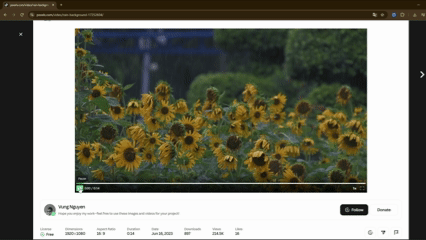

# QualityBuffer

[](https://chromewebstore.google.com/detail/mdefdlcocdakdpkgfhpnhdcjihaajomg)
[](https://github.com/Alves404/QualityBuffer/releases/latest)
[](manifest.json)
[-4285F4.svg)](src/popup/popup.css)
[](LICENSE)
[](src/)

> [!TIP]
> ### 🚀 O que é o QualityBuffer? (Visão Geral em Português)
> O **QualityBuffer** é uma extensão leve, gratuita e de código aberto para Google Chrome projetada para **rodar vídeos em alta resolução (4K, 2K e 1080p) no YouTube com fluidez, sem engasgos e sem "Erro de Reprodução"**, mesmo em computadores modestos ou redes instáveis.
>
> A extensão atua **100% dentro dos Termos de Serviço do YouTube e das diretrizes da Chrome Web Store**: utiliza preferência não-destrutiva de hardware na GPU (**VP9 SDR** via `MediaCapabilities`), controle oficial de qualidade *Ad-Safe*, perfis adaptativos contra queda de quadros e inclui um **Downloader V12 integrado (MP4 e MP3 com 1 clique)** exclusivo para páginas web externas. Sem anúncios, sem telemetria externa e sem coleta de dados.
>
> ---
>
> ### 🚀 What is QualityBuffer? (Quick User Overview)
> **QualityBuffer** is a lightweight, free, Open Source Google Chrome extension engineered to **deliver smooth high-resolution YouTube playback (4K, 2K, and 1080p) without CPU bottlenecks, stuttering, or Playback Errors**, even on entry-level PCs or fluctuating connections.
>
> Operating **100% within YouTube's Terms of Service and Chrome Web Store policies**, it combines non-destructive GPU hardware codec hints (**VP9 SDR** via `MediaCapabilities`), *Ad-Safe* official quality control, adaptive frame-drop/rebuffer protection, and a built-in **1-click V12 Downloader (MP4 & MP3)** for external websites. Zero ads, zero tracking, and 100% local execution.

Conceived, architected, and engineered in a human manner by **João Vitor Magalhães Alves (@Alves404)**, **QualityBuffer v2.3.0** pairs a rock-solid, protocol-safe YouTube playback stability engine with a **12-worker HLS (`M3U8` / `AES-128`) & Direct `MP4`/`WebM` external video downloader**, presented in a native **Google Chrome WebUI / Material Design 3** interface.

<p align="center">
  
</p>

---

## Installation & Quick Links

[](https://chromewebstore.google.com/detail/mdefdlcocdakdpkgfhpnhdcjihaajomg)

1. **Chrome Web Store (Recommended — 1-Click Install):**
   Install directly from the official store listing: [chromewebstore.google.com/detail/mdefdlcocdakdpkgfhpnhdcjihaajomg](https://chromewebstore.google.com/detail/mdefdlcocdakdpkgfhpnhdcjihaajomg)
2. **Manual Installation (Developer Mode / Unpacked):**
   * Download [**`QualityBuffer-v2.3.0.zip`**](https://github.com/Alves404/QualityBuffer/releases/download/v2.3.0/QualityBuffer-v2.3.0.zip) from [GitHub Releases](https://github.com/Alves404/QualityBuffer/releases) and extract it to a permanent folder.
   * Open `chrome://extensions/` in Google Chrome, Brave, or Edge.
   * Enable **Developer mode** (top-right) and click **Load unpacked** (top-left), selecting the extracted folder containing [`manifest.json`](manifest.json).

* **Privacy Policy (100% Client-Side):** [`PRIVACY_POLICY.md`](PRIVACY_POLICY.md)
* **Technical Engineering Report:** [`docs/TECHNICAL_REPORT.md`](docs/TECHNICAL_REPORT.md)
* **Landing Page & Docs:** [`docs/index.html`](docs/index.html) | [`CHANGELOG.md`](CHANGELOG.md)

---

## Table of Contents

1. [Engineering Architecture (v2.3.0 — Safe & ToS-Compliant)](#1-engineering-architecture-v230--safe--tos-compliant)
2. [Playback Stability Profiles](#2-playback-stability-profiles)
3. [Key Features](#3-key-features)
4. [Chrome Native UI Design System (Material Design 3)](#4-chrome-native-ui-design-system-material-design-3)
5. [V12 External Web Video & HLS Downloader](#5-v12-external-web-video--hls-downloader)
6. [Development, Verification & Build Scripts](#6-development-verification--build-scripts)
7. [Repository Structure](#7-repository-structure)
8. [Human Software Architecture & Credits](#8-human-software-architecture--credits)

---

## 1. Engineering Architecture (v2.3.0 — Safe & ToS-Compliant)

Entry-level and mid-range computers (e.g., quad-core CPUs and 4 GB VRAM GPUs) frequently suffer from frame drops or stalls during 4K streaming—not due to slow internet, but due to software codec overhead, heavy background shaders, and rigid quality locks. **QualityBuffer v2.3.0** solves these bottlenecks using strictly standard, non-destructive APIs with **zero `Object.prototype` pollution, zero SABR protocol spoofing, and zero telemetry blocking**:

1. **Non-Destructive `MediaCapabilities` Hardware Codec Hinting:**
   YouTube defaults to AV1 (`av01`) on high-resolution streams, forcing GPUs without hardware AV1 decoders into 90–100% CPU software decoding (`dav1d`). Instead of returning `supported: false` in `MediaSource.isTypeSupported` (which triggers *"Playback Error"* on AV1-only videos, Shorts, or ads), [`page-hook.js`](src/content/page-hook.js) awaits the browser's native `navigator.mediaCapabilities.decodingInfo()` result and adjusts only `{ smooth: false, powerEfficient: false }` on `av01`, 10-bit HDR (`vp09.02`), and optional `>30fps` configs. YouTube naturally selects GPU hardware **VP9 Profile 0 (8-bit SDR)** whenever available while keeping AV1-only streams 100% playable.
2. **Ad-Safe & Error-Safe Official `#movie_player` Quality Control:**
   Applies the preferred resolution (`2160p`, `1440p`, `1080p`) once per video via YouTube's public `#movie_player` API strictly on watch pages after metadata loads (`video.readyState >= 1`). Automatically pauses intervention during advertisements (`ad-showing`, `getAdState() === 1`), error overlays (`.ytp-error`), Shorts, and hover previews, and listens to `onPlaybackQualityChange` so manual quality selections in YouTube's gear menu are always respected.
3. **Passive `PerformanceObserver` CDN Warm-up & Live Telemetry:**
   Uses a passive `PerformanceObserver` (`resource`) to pre-warm active `googlevideo.com` media origins (`dns-prefetch` + `preconnect`, capped at 6 origins) without overriding `window.fetch`, `XMLHttpRequest`, or `navigator.sendBeacon`. Real-time buffer health (`video.buffered`), frame drop rate (`getVideoPlaybackQuality()`), and passive CDN throughput (`Mbps`) are displayed live in the popup.
4. **Conservative MSE Micro-Gap Recovery & GPU Compositor Offload:**
   Steps across sub-second timestamp gaps in `video.buffered` only after a verified freeze (`>= 2.6s` stationary outside ads and seeking), and disables GPU-heavy Ambient Mode canvas blur shaders via [`player-optimize.css`](src/content/player-optimize.css) (`contain: layout paint`).

---

## 2. Playback Stability Profiles

Users can tailor how aggressively the **Adaptive Drop & Rebuffer Guard** protects playback smoothness in [`popup.html`](src/popup/popup.html):

| Stability Profile | Frame-Drop Step-Down Threshold | Rebuffer Stall Threshold | Extra GPU Optimizations | Best For |
| :--- | :--- | :--- | :--- | :--- |
| **Balanced *(Recommended)*** | `> 15%` dropped frames *(min 180 frames)* | `3` stalls within `25s` | Respects individual feature toggles | Daily 4K/1440p viewing on mid-range PCs |
| **Strict Quality** | `> 22%` dropped frames *(min 240 frames)* | `4` stalls within `30s` | Holds target resolution longer | High-bandwidth connections & dedicated GPUs |
| **GPU & Network Saver** | `> 10%` dropped frames *(min 120 frames)* | `2` stalls within `20s` | Auto-prioritizes `<= 30fps` & disables Ambient Mode | Laptops, integrated/4 GB GPUs & unstable Wi-Fi |

---

## 3. Key Features

* **Zero Playback Error Guarantee:** Leaves `MediaSource.isTypeSupported`, `canPlayType`, `fetch`, `XHR`, `JSON.parse`, and YouTube QoE/analytics endpoints completely untouched.
* **Hardware VP9 SDR & 30fps Preference:** Guides `MediaCapabilities` toward smooth hardware decoding on modest GPUs.
* **Adaptive Resolution Step-Down:** Smoothly steps down one tier (`4K → 2K → 1080p → 720p`) if hardware decoding or network bandwidth falls behind.
* **Least-Privilege Manifest V3 Security:** Scoped strictly to `*://*.youtube.com/*` and `*://*.googlevideo.com/*`—zero `<all_urls>` broad host permissions. External pages are inspected strictly on-demand via `activeTab` upon user click.
* **Zero-Reload Live Apply:** Hot-applies configuration updates immediately to the active player with visual Applied/Pending pill feedback.
* **Zero-Overhead Internationalization (`O(1)`):** Instant localization in **English (`EN`)**, **Portuguese (`PT`)**, and **Spanish (`ES`)** with automatic browser locale detection.

---

## 4. Chrome Native UI Design System (Material Design 3)

The popup interface ([`popup.css`](src/popup/popup.css)) is crafted to be visually and functionally indistinguishable from native Google Chrome Desktop surfaces:

* **Tonal Surface Hierarchy:** Built exclusively with Material Design 3 surface containers (`--md-sys-color-surface`, `--md-sys-color-surface-container-low`, `--md-sys-color-surface-container`, `--md-sys-color-surface-container-high`)—no web landing-page drop shadows, decorative gradients, or harsh borders.
* **Automatic Light & Dark Themes:** Native `@media (prefers-color-scheme: dark)` support using official Chrome Light & Dark color tokens.
* **M3 Expressive Motion:** Fluid transitions driven by `--md-motion-standard`, `--md-motion-emphasized-decelerate`, and `--md-motion-emphasized-accelerate`.

---

## 5. V12 External Web Video & HLS Downloader

For non-YouTube websites (courses, media portals, and standard HTML5/HLS players), **QualityBuffer** includes an on-demand download assistant activated via `activeTab`:

1. **Strict Policy Compliance:** Automatically disabled on `youtube.com`, `youtu.be`, and `googlevideo.com` in full compliance with Chrome Web Store Developer Program Policies and YouTube Terms of Service.
2. **Master Playlist & Token Preservation:** Parses `.m3u8` manifests to select the highest-bandwidth `#EXT-X-STREAM-INF` stream while preserving signed CDN query tokens (`DownloaderUtils.resolveSecureUrl`).
3. **WebCrypto AES-128 Decryption & 12-Worker Concurrency:** Pre-warms `#EXT-X-KEY` keys asynchronously via `crypto.subtle` and downloads segments across 12 parallel workers with 5 ms main-thread yielding (`yieldThread`) and MP4/MP3 output options.

---

## 6. Development, Verification & Build Scripts

Requires **Node.js `>= 16.0.0`** (zero external npm runtime dependencies):

```powershell
# Check JavaScript syntax across all Service Worker, Content, Core, and Popup modules
npm run verify

# Run automated unit tests (DownloaderUtils, V12 M3U8/AES-128 parser & YouTube ToS safety checks)
npm test

# Validate Manifest V3 CWS compliance and build chrome-web-store/QualityBuffer-v2.3.0.zip
npm run build:cws
```

---

## 7. Repository Structure

```text
QualityBuffer/
├── manifest.json                 # Chrome Manifest V3 configuration (v2.3.0)
├── package.json                  # Verification, unit test & CWS packaging scripts
├── PRIVACY_POLICY.md             # 100% client-side privacy & permission disclosures
├── CHANGELOG.md                  # Version history and technical release notes
├── LICENSE                       # GNU General Public License v3.0 (GPL-3.0 Copyleft)
├── README.md                     # Project documentation & architectural overview
├── scripts/
│   └── build-cws.js              # Chrome Web Store policy validator & ZIP builder
├── assets/
│   ├── icons/                    # Toolbar & store icons (16px, 32px, 48px, 128px)
│   └── images/                   # Workflow demonstration GIF & documentation media
├── src/
│   ├── background/
│   │   └── service-worker.js     # Per-tab state store & passive googlevideo throughput monitor
│   ├── core/
│   │   ├── utils.js              # Signed URL resolver, AES-128 IV parser & sanitizers
│   │   └── hls-downloader.js     # V12 12-worker HLS/AES-128 downloader & Blob assembler
│   ├── content/
│   │   ├── page-hook.js          # MAIN world: Safe MediaCapabilities hints & stability guard
│   │   ├── content-controller.js # ISOLATED world bridge, activeTab media scanner & HLS runner
│   │   └── player-optimize.css   # GPU compositor layer promotion & Ambient Mode saver
│   └── popup/
│       ├── popup.html            # Chrome Native UI popup markup (Controls & About)
│       ├── popup.css             # Material Design 3 / Chrome WebUI tonal stylesheet
│       └── popup.js              # Popup state controller, live telemetry & O(1) i18n engine
├── tests/
│   └── test-core.js              # Automated unit & YouTube ToS static safety test suite
└── docs/
    ├── index.html                # Official landing page & installation guide
    └── TECHNICAL_REPORT.md       # Deep-dive engineering report & compliance matrix
```

---

## 8. Human Software Architecture & Credits

<p align="center">
  
</p>

All software architecture, systems engineering, media pipeline design, and product decisions in **QualityBuffer** were conceived, planned, and designed in a human manner by **João Vitor Magalhães Alves (@Alves404)** (Google Student Ambassador 2026).

Artificial Intelligence tools functioned exclusively as development and code review assistants under direct human supervision and engineering direction.

* **Creator, Software Architect & Maintainer:** João Vitor Magalhães Alves — **Google Student Ambassador 2026** — [github.com/Alves404](https://github.com/Alves404) (`@Alves404`)
* **Official Repository:** [github.com/Alves404/QualityBuffer](https://github.com/Alves404/QualityBuffer)
* **Chrome Web Store:** [QualityBuffer on Chrome Web Store](https://chromewebstore.google.com/detail/mdefdlcocdakdpkgfhpnhdcjihaajomg)
* **Development Assistance:** AI coding and code review assistant under human direction
* **Supported Languages:** English (`EN` - Default), Portuguese (`PT`), and Spanish (`ES`)
* **License:** GNU General Public License v3.0 (`GPL-3.0` Copyleft Open Source)
* **Version:** `2.3.0` (Manifest V3 — Safe Hardware VP9 Engine, Adaptive Stability Guard & V12 HLS/MP4 Downloader)

<sub>*Google Chrome, YouTube, and related marks are trademarks of Google LLC. This independent open-source project is not affiliated with or endorsed by Google LLC.*</sub>
