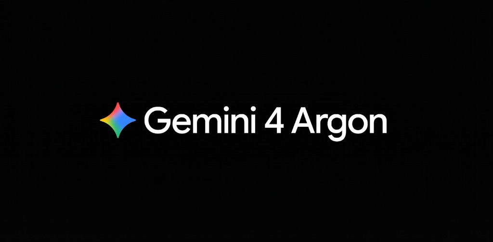

# QualityBuffer

[](https://chromewebstore.google.com/detail/mdefdlcocdakdpkgfhpnhdcjihaajomg)
[](https://github.com/Alves404/QualityBuffer/releases/latest)
[](manifest.json)
[-4285F4.svg)](src/popup/popup.css)
[](LICENSE)
[](src/)

> [!TIP]
> ### 🚀 O que é o QualityBuffer? (Visão Geral para Usuários)
> O **QualityBuffer** é uma extensão leve e gratuita para Google Chrome criada para **permitir rodar vídeos em alta resolução (4K, 2K e 1080p) sem gargalo, travamentos ou erros de reprodução**, mesmo em computadores mais modestos ou com conexões de internet instáveis.
>
> A extensão utiliza preferência inteligente de hardware na GPU (**VP9 SDR** via `MediaCapabilities`), perfis adaptativos de estabilidade contra queda de quadros e inclui uma ferramenta integrada para **detectar e baixar vídeos e áudios (MP4 e MP3) com 1 clique** em páginas web externas. Tudo 100% gratuito, sem anúncios, sem rastreamento e de código aberto.
>
> ---
>
> ### 🚀 What is QualityBuffer? (Quick User Overview)
> **QualityBuffer** is a lightweight, free Google Chrome extension designed to **play high-resolution videos (4K, 2K, and 1080p) smoothly without bottlenecks, stuttering, or playback errors**, even on entry-level computers or fluctuating internet connections.
>
> Powered by non-destructive GPU hardware codec hints (**VP9 SDR** via `MediaCapabilities`) and adaptive frame-drop/rebuffer protection, it also includes a built-in assistant to **detect and download external web videos and audio (MP4 & MP3) in 1 click** directly in your browser. 100% free, zero ads, zero data tracking, and open source.

**QualityBuffer** is a high-performance, Open Source browser extension (Manifest V3) engineered to deliver stutter-free **4K (2160p Ultra HD)** YouTube video playback on entry-level and mid-range PCs, featuring an integrated **V12 12-Worker HLS (`M3U8` / `AES-128`) & Direct `MP4`/`WebM` Web Video Downloader** and a native **Chrome WebUI / Material Design 3** interface.

Conceived, architected, and engineered by **João Vitor Magalhães Alves (@Alves404)**, the extension eliminates CPU decoding spikes and playback stalls through **non-destructive `MediaCapabilities` VP9 Profile 0 SDR hardware preference**, **Ad-Safe official `#movie_player` quality control**, **passive `PerformanceObserver` CDN preconnect warm-up**, and **adaptive frame-drop & micro-gap recovery**—operating 100% within YouTube's Terms of Service with zero private protocol tampering.

<p align="center">
  
</p>

---

## Chrome Web Store Installation

[](https://chromewebstore.google.com/detail/mdefdlcocdakdpkgfhpnhdcjihaajomg)

> [!TIP]
> **QualityBuffer** is officially published, verified, and available in the **Google Chrome Web Store** in full compliance with Manifest V3 policies.
> 
> * **Official Chrome Web Store URL:** [chromewebstore.google.com/detail/mdefdlcocdakdpkgfhpnhdcjihaajomg](https://chromewebstore.google.com/detail/mdefdlcocdakdpkgfhpnhdcjihaajomg)
> * **Releases & Source Code:** [github.com/Alves404/QualityBuffer/releases](https://github.com/Alves404/QualityBuffer/releases)
> * **Privacy Policy (100% Client-Side Privacy):** [`PRIVACY_POLICY.md`](PRIVACY_POLICY.md)

---

## Direct Download & Documentation

* **Download Latest Release Package:** [QualityBuffer-v2.3.0.zip](https://github.com/Alves404/QualityBuffer/releases/download/v2.3.0/QualityBuffer-v2.3.0.zip)
* **GitHub Releases Archive:** [github.com/Alves404/QualityBuffer/releases](https://github.com/Alves404/QualityBuffer/releases)
* **Privacy Policy:** [`PRIVACY_POLICY.md`](PRIVACY_POLICY.md)
* **Technical Engineering Report:** [`docs/TECHNICAL_REPORT.md`](docs/TECHNICAL_REPORT.md)
* **Documentation Website:** [`docs/index.html`](docs/index.html)

---

## Table of Contents

1. [The Engineering Problem & Architecture Solution](#1-the-engineering-problem--architecture-solution)
2. [Key Features (v2.3.0)](#2-key-features-v230)
3. [Chrome Native UI Design System (Material Design 3)](#3-chrome-native-ui-design-system-material-design-3)
4. [V12 Async Warm-up & Web Video Downloader](#4-v12-async-warm-up--web-video-downloader)
5. [Repository Structure](#5-repository-structure)
6. [AI-Assisted Development Notice (Gemini 4 Argon)](#6-ai-assisted-development-notice-gemini-4-argon)
7. [Credits & Authorship](#7-credits--authorship)

---

## 1. The Engineering Problem & Architecture Solution

Modern desktop hardware with quad-core processors and budget GPUs (e.g. 4 GB VRAM) often struggles to stream 4K video reliably—not because of internet speed, but due to four systemic bottlenecks in default web player stacks:

1. **Software AV1 CPU Decoding Overhead (Solved via Non-Destructive `MediaCapabilities` Hinting):**
   YouTube serves high-resolution streams in AV1 (`av01`) by default. Graphics cards without hardware AV1 decoding offload processing to the CPU via software threads (`dav1d`), consuming 90–100% of CPU time and inducing heavy frame drops. Instead of blocking codecs with `supported: false` (which causes Playback Errors on AV1-only videos or ads), **QualityBuffer** wraps `navigator.mediaCapabilities.decodingInfo()` non-destructively—preserving `supported: true` while marking `smooth: false, powerEfficient: false` on software-heavy codecs so YouTube's ABR selector naturally prefers hardware-accelerated **VP9 Profile 0 (8-bit SDR)**.
2. **Ad-Safe Official `#movie_player` Quality Control & Adaptive Stability Guard:**
   Applies the user's target resolution (`2160p`, `1440p`, `1080p`) via YouTube's official `#movie_player` API strictly after video metadata loads and never during active advertisements (`ad-showing`), Shorts, or manual user gear-menu changes. If severe frame drops or repeated rebuffer stalls occur, the **Adaptive Stability Guard** smoothly steps down one resolution tier to keep playback uninterrupted.
3. **Conservative MSE Micro-Gap Recovery & Passive CDN Warm-up:**
   Monitors `video.buffered` ranges to bridge sub-second timestamp gaps only after genuine multi-second stalls, while a passive **`PerformanceObserver`** (`resource`) pre-warms active `googlevideo.com` CDN origins (`dns-prefetch` and `preconnect`) without hooking `fetch`, `XHR`, or `sendBeacon`.
4. **Heavy Visual Canvas & Shader Offload:**
   YouTube's decorative "Ambient Mode" renders blurred canvas lighting effects around the video element, consuming valuable GPU fill-rate and VRAM. The extension disables Ambient Mode canvas layers via CSS (`contain: layout paint`) to dedicate graphics resources to 4K frame presentation.

---

## 2. Key Features (v2.3.0)

* **Non-Destructive Hardware VP9 & SDR Preference:** Guides `MediaCapabilities.decodingInfo` toward GPU hardware VP9 SDR and optional 30fps without ever triggering "Playback Error" on AV1-only streams, Shorts, or advertisements.
* **Playback Stability Profiles (*Balanced*, *Strict Quality*, *GPU & Network Saver*):** Tailors frame-drop and rebuffer step-down thresholds to match your hardware and connection profile.
* **Integrated V12 Web Video Downloader:** Detects downloadable streams on external web pages (HLS `.m3u8` playlists and direct MP4/WebM files) via on-demand `activeTab` inspection, downloading with 12 concurrent workers and WebCrypto AES-128 decryption. Strictly respects Chrome Web Store and YouTube policies by disabling downloads on YouTube.
* **Chrome Native UI (Material Design 3 / Chrome WebUI):** Seamlessly integrates with Google Chrome Desktop aesthetics using M3 tonal surfaces and automatic Light & Dark mode adaptation (`prefers-color-scheme: dark`).
* **Conservative MSE Stabilizer & Adaptive Drop Guard:** Heals SourceBuffer timestamp micro-gaps after verified stalls and steps down resolution gracefully if frame loss exceeds profile limits.
* **Zero-Reload Dynamic Control Engine:** Settings changes apply immediately to the active player via message dispatch without requiring a page reload (F5) or abrupt seeks.
* **Strict Privacy (Zero External Telemetry):** Operates 100% client-side inside the browser. No tracking, no analytical telemetry, no remote scripts, and no external servers.
* **Zero-Overhead Internationalization:** Built-in instant switching between English (`EN`), Portuguese (`PT`), and Spanish (`ES`) with automatic browser language detection.

---

## 3. Chrome Native UI Design System (Material Design 3)

The extension interface is built to be visual and functional indistinguishable from native Google Chrome Desktop components (such as Chrome Side Panel, History, and Settings):

* **Tonal Elevation Hierarchy:** Card surfaces, control clusters, and metrics containers are structured strictly via Material Design 3 surface containers (`--md-sys-color-surface`, `--md-sys-color-surface-container`, `--md-sys-color-surface-container-high`), eliminating harsh landing-page shadows, decorative gradients, and solid `#050505` borders.
* **Automatic Theme Adaptation:** Fully dynamic `@media (prefers-color-scheme: dark)` color tokens adhering to the official Chrome WebUI palette for both Light Mode and Dark Mode.
* **M3 Motion Curves:** Smooth, native micro-interactions driven by `--md-motion-standard`, `--md-motion-emphasized-decelerate`, and `--md-motion-emphasized-accelerate`.
* **Streamlined 2-Tab Navigation:** Direct access to **Controls** (real-time telemetry, target quality, stability profile, integrated video downloader, and features matrix) and **About & Credits**.

---

## 4. V12 Async Warm-up & Web Video Downloader

The **V12 Engine** powers fast, non-blocking media acquisition and streaming optimization:

1. **Passive `PerformanceObserver` CDN Preconnect (`page-hook.js`):** Observes media resource entries passively to pre-warm CDN origins without overriding `window.fetch` or `XMLHttpRequest`.
2. **Asynchronous Key & CDN Pre-Warming:** Resolves `#EXT-X-KEY` definitions asynchronously via WebCrypto (`crypto.subtle`) in background promises so workers begin segment decryption with zero pipeline latency.
3. **Adaptive Master Playlist Variant Selector:** Automatically selects the highest bandwidth `#EXT-X-STREAM-INF` track while preserving signed CDN security tokens (`resolveSecureUrl`).
4. **12-Worker Anti-Stutter Concurrency:** Downloads chunks using 12 concurrent workers with cooperative event-loop yielding (`yieldThread(5ms)`) during decoding and MP4 Blob assembly to prevent active playback frame drops.

---

## 5. Repository Structure

```text
QualityBuffer/
├── manifest.json                 # Manifest V3 configuration (v2.3.0)
├── package.json                  # Test runner, syntax verification & packaging scripts
├── PRIVACY_POLICY.md             # Privacy Policy (100% client-side, zero data collection)
├── LICENSE                       # GNU General Public License v3.0 (GPL-3.0 Copyleft)
├── README.md                     # Main documentation & user guide
├── CHANGELOG.md                  # Release history and technical changelogs
├── scripts/
│   └── build-cws.js              # CWS policy validator & ZIP packager
├── assets/
│   └── icons/                    # Extension icons (16px, 32px, 48px, 128px)
├── src/
│   ├── background/
│   │   └── service-worker.js     # Per-tab telemetry store & passive stream classifier
│   ├── core/
│   │   ├── utils.js              # URL sanitizers, AES-128 IV parsers & event-loop utilities
│   │   └── hls-downloader.js     # V12 12-worker HLS/AES-128 engine & MP4 Blob builder
│   ├── content/
│   │   ├── page-hook.js          # MAIN world: Safe MediaCapabilities VP9 hints & stability guard
│   │   ├── content-controller.js # ISOLATED world bridge, SPA route watcher & HLS runner
│   │   └── player-optimize.css   # GPU rendering layer promotion & Ambient Mode neutralizer
│   └── popup/
│       ├── popup.html            # Chrome Native UI interface (Controls + About tabs)
│       ├── popup.css             # Material Design 3 / Chrome WebUI stylesheet
│       └── popup.js              # Popup controller, integrated downloader UI & O(1) i18n
├── tests/
│   └── test-core.js              # Automated unit tests for DownloaderUtils & V12 engine
└── docs/
    ├── index.html                # GitHub Pages documentation & release landing page
    └── TECHNICAL_REPORT.md       # Architectural deep-dive and benchmark verification
```

---

## 6. AI-Assisted Development Notice (Gemini 4 Argon)

<p align="center">
  
</p>

All software architecture, systems engineering, media pipeline design, and product decisions in **QualityBuffer** were conceived, planned, and designed in a human manner by **João Vitor Magalhães Alves (@Alves404)** (Google Student Ambassador 2026).

Artificial Intelligence tools (**Gemini 4 Argon** via Google Antigravity) functioned strictly as an AI programming assistant and code reviewer for technical implementation, optimizations, and documentation under direct human supervision and guidelines.

---

## 7. Credits & Authorship

* **Author, Software Architect & Maintainer:** João Vitor Magalhães Alves — **Google Student Ambassador 2026** — [github.com/Alves404](https://github.com/Alves404) (`@Alves404`)
* **Official Repository:** [github.com/Alves404/QualityBuffer](https://github.com/Alves404/QualityBuffer)
* **AI-Assisted Development:** Gemini 4 Argon (Google Antigravity) — AI programming assistant for implementation and review under human direction
* **Supported Languages:** English (`EN` - Default), Portuguese (`PT`), and Spanish (`ES`) with automatic browser detection
* **License:** GNU General Public License v3.0 (`GPL-3.0` Copyleft Open Source)
* **Version:** `2.3.0` (Manifest V3 — Safe Hardware VP9 Engine, Adaptive Stability Guard & CWS-Compliant V12 Downloader)

<sub>*Google Chrome, Google Gemini, and YouTube are trademarks of Google LLC. This open-source project is independently developed and not affiliated with or endorsed by Google LLC.*</sub>
