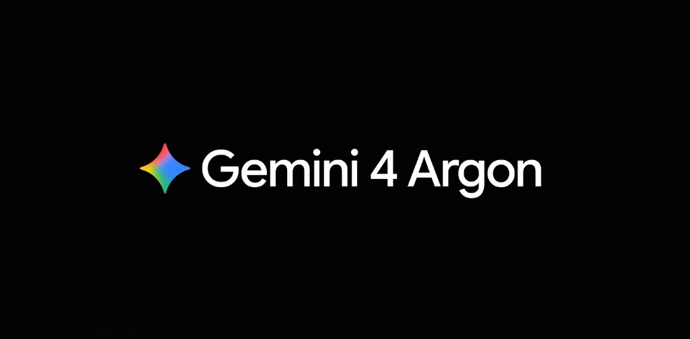

# My Quality 4k

[](https://chromewebstore.google.com)
[](https://github.com/Alves404/My-Quality-4k/releases/latest)
[](manifest.json)
[-4285F4.svg)](src/popup/popup.css)
[](LICENSE)
[](src/)

> [!TIP]
> ### 🚀 O que é o My Quality 4k? (Visão Geral para Usuários)
> O **My Quality 4k** é uma extensão leve e gratuita para Google Chrome criada para **permitir rodar vídeos em alta resolução (4K, 2K e 1080p) sem gargalo, travamentos ou buffering constante**, mesmo em computadores mais modestos ou com conexões de internet instáveis.
>
> Além de eliminar travamentos desbloqueando até **3 minutos de pré-carregamento contínuo** e ativando aceleração direta por hardware na GPU, a extensão inclui uma ferramenta integrada para **detectar e baixar vídeos e áudios/músicas (MP4 e MP3) com 1 clique** direto no navegador. Tudo 100% gratuito, sem anúncios, sem rastreamento e de código aberto.
>
> ---
>
> ### 🚀 What is My Quality 4k? (Quick User Overview)
> **My Quality 4k** is a lightweight, free Google Chrome extension designed to **play high-resolution videos (4K, 2K, and 1080p) smoothly without bottlenecks, stuttering, or constant buffering**, even on entry-level computers or fluctuating internet connections.
>
> In addition to eliminating video stutter with up to **3 minutes of continuous deep pre-buffering** and GPU hardware acceleration, it includes a built-in assistant to **detect and download videos and audio (MP4 & MP3) in 1 click** directly in your browser. 100% free, zero ads, zero data tracking, and open source.

**My Quality 4k** is a high-performance, Open Source browser extension (Manifest V3) engineered to unlock stutter-free **4K (2160p Ultra HD)** YouTube video playback on entry-level and mid-range PCs, featuring an integrated **V12 12-Worker HLS (`M3U8` / `AES-128`) & Direct `MP4`/`WebM` Web Video Downloader** and a native **Chrome WebUI / Material Design 3** interface.

Conceived, architected, and engineered by **João Vitor Magalhães Alves (@Alves404)**, the extension tackles YouTube's strict client buffering bottlenecks by lifting the SABR **35 MB (16-second)** buffer ceiling to **512 MB**, allowing the browser to cache **1, 2, or 3 full minutes** of upcoming 4K video ahead of the playhead. Combined with automatic **VP9 Profile 0 SDR hardware decoding enforcement** and **MSE micro-gap bridging**, it eliminates CPU decoding spikes and delivers fluid playback regardless of local connection jitter.

---

## Chrome Web Store Installation

[](https://chromewebstore.google.com/detail/YOUR_EXTENSION_ID)

> [!NOTE]
> **My Quality 4k** is packaged and prepared for the official **Google Chrome Web Store** in full compliance with Manifest V3 policies.
> 
> * **Official Chrome Web Store URL:** `https://chromewebstore.google.com/detail/YOUR_EXTENSION_ID` *(Link will be updated upon store publication approval)*
> * **Releases & Source Code:** [github.com/Alves404/My-Quality-4k/releases](https://github.com/Alves404/My-Quality-4k/releases)
> * **Privacy Policy (100% Client-Side Privacy):** [`PRIVACY_POLICY.md`](PRIVACY_POLICY.md)

---

## Direct Download & Documentation

* **Download Latest Release Package:** [My-Quality-4k-v2.2.1.zip](https://github.com/Alves404/My-Quality-4k/releases/download/v2.2.1/My-Quality-4k-v2.2.1.zip)
* **GitHub Releases Archive:** [github.com/Alves404/My-Quality-4k/releases](https://github.com/Alves404/My-Quality-4k/releases)
* **Privacy Policy:** [`PRIVACY_POLICY.md`](PRIVACY_POLICY.md)
* **Technical Engineering Report:** [`docs/TECHNICAL_REPORT.md`](docs/TECHNICAL_REPORT.md)
* **Documentation Website:** [`docs/index.html`](docs/index.html)

---

## Table of Contents

1. [The Engineering Problem & Architecture Solution](#1-the-engineering-problem--architecture-solution)
2. [Key Features (v2.2.1)](#2-key-features-v221)
3. [Chrome Native UI Design System (Material Design 3)](#3-chrome-native-ui-design-system-material-design-3)
4. [V12 Async Warm-up & Web Video Downloader](#4-v12-async-warm-up--web-video-downloader)
5. [Repository Structure](#5-repository-structure)
6. [AI-Assisted Development Notice (Gemini 4 Argon)](#6-ai-assisted-development-notice-gemini-4-argon)
7. [Credits & Authorship](#7-credits--authorship)

---

## 1. The Engineering Problem & Architecture Solution

Modern desktop hardware with quad-core processors and budget GPUs (e.g. 4 GB VRAM) often struggles to stream 4K video reliably—not because of internet speed (which typically exceeds 30–50 Mbps), but due to four systemic bottlenecks in default web player stacks:

1. **Hardcoded 35 MB (~16-Second) 4K Buffer Ceiling in YouTube's SABR Player:**
   When playing video above 1080p, YouTube's internal SABR memory policy restricts buffer retention to `36,700,160` bytes (**35 MB**, or roughly **16 seconds** of 4K bitstream). Any network packet delay immediately drains this narrow buffer, causing constant stalls and quality drops. **My Quality 4k** intercepts the internal player policy via prototype descriptors to expand the buffer pool to **512 MB** (`536,870,912` bytes) for video and **64 MB** for audio, keeping **60s, 120s, or 180s** of pre-buffered 4K content continuously loaded ahead of the playhead.
2. **Software AV1 CPU Decoding Overhead:**
   YouTube serves high-resolution streams in AV1 (`av01`) by default. Graphics cards without hardware AV1 decoding capabilities offload processing to the CPU via software threads (`dav1d`), consuming 90–100% of CPU time and inducing heavy frame drops. The extension intercepts `MediaSource.isTypeSupported`, `HTMLMediaElement.prototype.canPlayType`, and `navigator.mediaCapabilities.decodingInfo` to block AV1 and 10-bit HDR, enforcing lightweight **VP9 Profile 0 (8-bit SDR)** decoding natively handled by GPU hardware.
3. **MSE SourceBuffer Discontinuities & Initial Handshake Lag:**
   Sub-second timestamp gaps between adjacent Media Source segments trigger player buffering state changes. The extension bridges these micro-gaps dynamically while pre-warming CDN edge connections (`dns-prefetch` and `preconnect` on DNS/TLS/QUIC) at millisecond zero.
4. **Heavy Visual Canvas & Shader Overload:**
   YouTube's decorative "Ambient Mode" renders blurred canvas lighting effects around the video element, consuming valuable GPU fill-rate and VRAM. The extension automatically disables Ambient Mode canvas layers to dedicate all graphics resources to video decoding.

> [!TIP]
> **Sub-4K Videos (1440p / 1080p / 720p):**
> Because lower-resolution streams have significantly lower bitrates, the 512 MB memory pool caches minutes of video almost instantaneously, enabling instant scrubbing with zero buffering.

---

## 2. Key Features (v2.2.1)

* **SABR 512 MB Deep Pre-Buffer (60s / 120s / 180s Horizon):** Replaces the stock 35 MB / 16s cap with a 512 MB readahead buffer that downloads the next minutes of video continuously at full connection speed.
* **Integrated V12 Web Video Downloader:** Detects downloadable streams on general web pages (HLS `.m3u8` playlists and direct MP4/WebM files) directly within the **Controls** panel, downloading with 12 concurrent workers and WebCrypto AES-128 decryption. Strictly respects Chrome Web Store policies by disabling downloads on YouTube.
* **Chrome Native UI (Material Design 3 / Chrome WebUI):** Seamlessly integrates with Google Chrome Desktop aesthetics using M3 tonal surfaces and automatic Light & Dark mode adaptation (`prefers-color-scheme: dark`).
* **VP9 Hardware Acceleration Enforcement:** Blocks CPU-bound AV1 decoding and 10-bit HDR tonemapping, prioritizing GPU hardware VP9 SDR with an optional 30fps limiter for entry-level GPUs.
* **MSE Buffer Stabilizer & Smart Drop Guard:** Continuously heals SourceBuffer segment timestamp gaps and safely steps down quality only if severe frame loss exceeds 18%.
* **Zero-Reload Dynamic Control Engine:** Settings changes apply instantly to the active player via message dispatch without requiring a page reload (F5).
* **Strict Privacy (Zero External Telemetry):** Operates 100% client-side inside the browser. No tracking, no analytical telemetry, no remote scripts, and no external servers.
* **Zero-Overhead Internationalization:** Built-in instant switching between English (`EN`), Portuguese (`PT`), and Spanish (`ES`) with automatic browser language detection.

---

## 3. Chrome Native UI Design System (Material Design 3)

The extension interface is built to be visual and functional indistinguishable from native Google Chrome Desktop components (such as Chrome Side Panel, History, and Settings):

* **Tonal Elevation Hierarchy:** Card surfaces, control clusters, and metrics containers are structured strictly via Material Design 3 surface containers (`--md-sys-color-surface`, `--md-sys-color-surface-container`, `--md-sys-color-surface-container-high`), eliminating harsh landing-page shadows, decorative gradients, and solid `#050505` borders.
* **Automatic Theme Adaptation:** Fully dynamic `@media (prefers-color-scheme: dark)` color tokens adhering to the official Chrome WebUI palette for both Light Mode and Dark Mode.
* **M3 Motion Curves:** Smooth, native micro-interactions driven by `--md-motion-standard`, `--md-motion-emphasized-decelerate`, and `--md-motion-emphasized-accelerate`.
* **Streamlined 2-Tab Navigation:** Direct access to **Controls** (real-time telemetry, target quality, pre-buffer horizon, integrated video downloader, and features matrix) and **About & Credits**.

---

## 4. V12 Async Warm-up & Web Video Downloader

The **V12 Engine** powers fast, non-blocking media acquisition and streaming optimization:

1. **Dual Interception Hook (`page-hook.js`):** Intercepts both `window.fetch` and `XMLHttpRequest.prototype.open` pipelines at `document_start` to detect media manifests and initialization segments.
2. **Asynchronous Key & CDN Pre-Warming:** Resolves `#EXT-X-KEY` definitions asynchronously via WebCrypto (`crypto.subtle`) in background promises so workers begin segment decryption with zero pipeline latency.
3. **Adaptive Master Playlist Variant Selector:** Automatically selects the highest bandwidth `#EXT-X-STREAM-INF` track while preserving signed CDN security tokens (`resolveSecureUrl`).
4. **12-Worker Anti-Stutter Concurrency:** Downloads chunks using 12 concurrent workers with cooperative event-loop yielding (`yieldThread(5ms)`) during decoding and MP4 Blob assembly to prevent active playback frame drops.

---

## 5. Repository Structure

```text
My-Quality-4k/
├── manifest.json                 # Manifest V3 configuration (v2.2.1)
├── package.json                  # Test runner, syntax verification & packaging scripts
├── PRIVACY_POLICY.md             # Privacy Policy (100% client-side, zero data collection)
├── LICENSE                       # GNU General Public License v3.0 (GPL-3.0 Copyleft)
├── README.md                     # Main documentation & user guide
├── CHANGELOG.md                  # Release history and technical changelogs
├── scripts/
│   └── build-cws.js              # CWS policy validator & ZIP packager
├── assets/
│   └── icons/                    # Extension icons (16px, 32px, 48px, 128px)
├── src/
│   ├── background/
│   │   └── service-worker.js     # Per-tab telemetry store & passive stream classifier
│   ├── core/
│   │   ├── utils.js              # URL sanitizers, AES-128 IV parsers & event-loop utilities
│   │   └── hls-downloader.js     # V12 12-worker HLS/AES-128 engine & MP4 Blob builder
│   ├── content/
│   │   ├── page-hook.js          # MAIN world: 512 MB SABR buffer unlocker & hardware VP9 hook
│   │   ├── content-controller.js # ISOLATED world bridge, SPA route watcher & HLS runner
│   │   └── player-optimize.css   # GPU rendering layer promotion & Ambient Mode neutralizer
│   └── popup/
│       ├── popup.html            # Chrome Native UI interface (Controls + About tabs)
│       ├── popup.css             # Material Design 3 / Chrome WebUI stylesheet
│       └── popup.js              # Popup controller, integrated downloader UI & O(1) i18n
├── tests/
│   └── test-core.js              # Automated unit tests for DownloaderUtils & V12 engine
└── docs/
    ├── index.html                # GitHub Pages documentation & release landing page
    └── TECHNICAL_REPORT.md       # Architectural deep-dive and benchmark verification
```

---

## 6. AI-Assisted Development Notice (Gemini 4 Argon)

<p align="center">
  
</p>

All software architecture, systems engineering, media pipeline design, and product decisions in **My Quality 4k** were conceived, planned, and designed in a human manner by **João Vitor Magalhães Alves (@Alves404)** (Google Student Ambassador 2026).

Artificial Intelligence tools (**Gemini 4 Argon** via Google Antigravity) functioned strictly as an AI programming assistant and code reviewer for technical implementation, optimizations, and documentation under direct human supervision and guidelines.

---

## 7. Credits & Authorship

* **Author, Software Architect & Maintainer:** João Vitor Magalhães Alves — **Google Student Ambassador 2026** — [github.com/Alves404](https://github.com/Alves404) (`@Alves404`)
* **Official Repository:** [github.com/Alves404/My-Quality-4k](https://github.com/Alves404/My-Quality-4k)
* **AI-Assisted Development:** Gemini 4 Argon (Google Antigravity) — AI programming assistant for implementation and review under human direction
* **Supported Languages:** English (`EN` - Default), Portuguese (`PT`), and Spanish (`ES`) with automatic browser detection
* **License:** GNU General Public License v3.0 (`GPL-3.0` Copyleft Open Source)
* **Version:** `2.2.1` (Manifest V3 — SABR 512 MB Buffer, Chrome Native UI M3 & CWS-Compliant V12 Downloader)

<sub>*Google Chrome, Google Gemini, and YouTube are trademarks of Google LLC. This open-source project is independently developed and not affiliated with or endorsed by Google LLC.*</sub>
